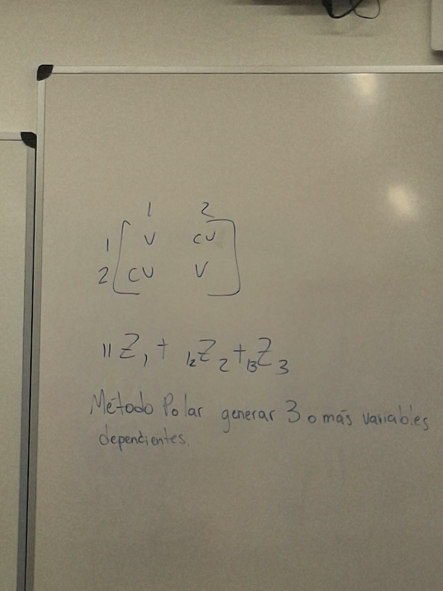
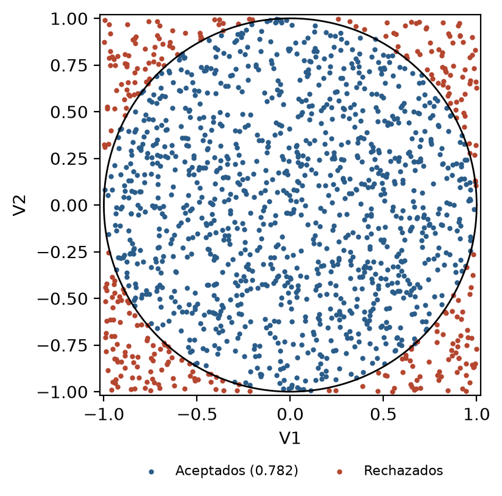
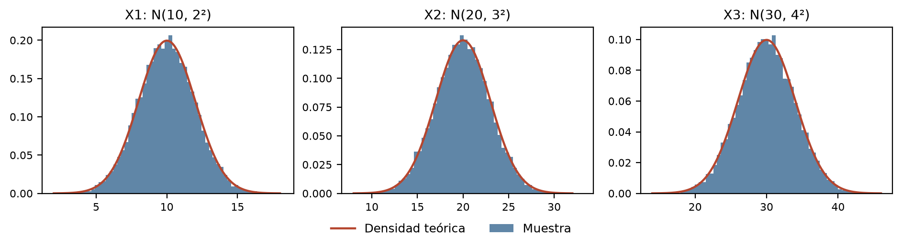
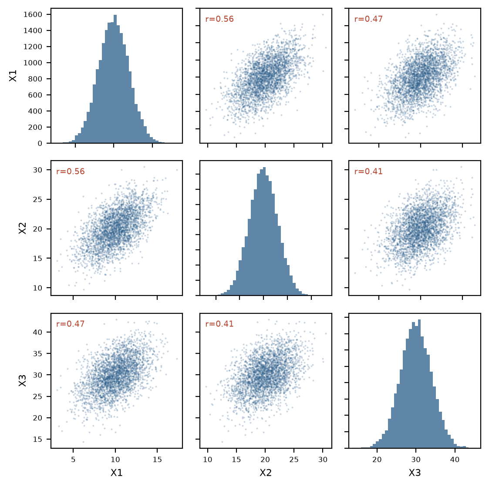
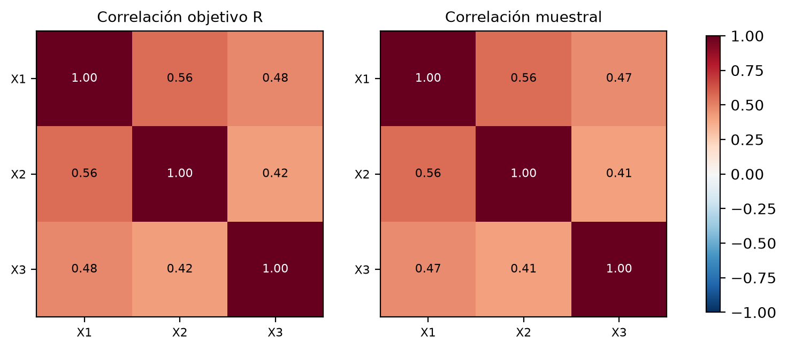
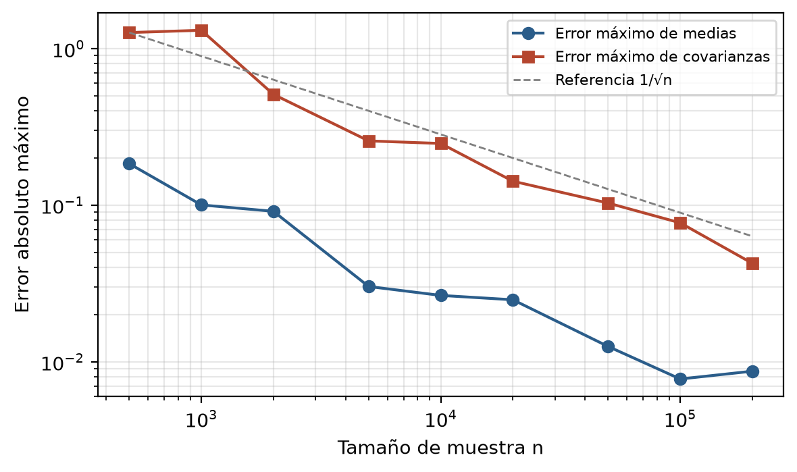

::: {custom-style="Portada"}
{{universidad}}

{{facultad}}

{{codigo}} {{curso}}, sección {{seccion}}
:::

::: {custom-style="Portada titulo"}
{{titulo}}
:::

::: {custom-style="Portada"}
{{nombre}}

Carné {{carne}}

Guatemala, {{fecha}}
:::

```{=openxml}
<w:p><w:r><w:br w:type="page"/></w:r></w:p>
```

# Resumen

Este trabajo presenta, demuestra e implementa un procedimiento para generar tres o más variables aleatorias normales dependientes con medias, varianzas y correlaciones prescritas. Las normales estándar independientes se obtienen con el método polar de Marsaglia, que parte únicamente de números uniformes y emplea un paso de aceptación y rechazo con probabilidad teórica de aceptación $\pi/4$ (Marsaglia & Bray, 1964). La dependencia se introduce después con la transformación lineal $\mathbf{X}=\boldsymbol{\mu}+L\mathbf{Z}$, donde $L$ es el factor de Cholesky de la matriz de varianza-covarianza $\Sigma=DRD$. Se demuestra que esta construcción produce $E[\mathbf{X}]=\boldsymbol{\mu}$ y $\operatorname{Cov}(\mathbf{X})=\Sigma$. La herramienta interactiva, escrita en Python con Streamlit, admite entre 3 y 8 variables, dos modelos de correlación válidos por construcción (factor común y equicorrelación), validación de la matriz y diagnósticos numéricos y gráficos. En el experimento de referencia ($n={{n}}$, semilla {{semilla}}) la tasa observada de aceptación fue {{tasa}}, frente a $\pi/4\approx0.7854$; el error absoluto máximo de las medias fue {{err_medias}} y el de las covarianzas {{err_cov}}.

**Palabras clave:** método polar de Marsaglia, distribución normal multivariable, matriz de covarianza, factorización de Cholesky, simulación.

# 1. Introducción y objetivo

Muchos modelos de simulación necesitan variables aleatorias que no sean independientes: rendimientos de activos, mediciones físicas relacionadas o tiempos de servicio que se afectan entre sí. Generar cada variable por separado ignora esa estructura. La distribución normal multivariable ofrece un modelo en el que toda la dependencia está descrita por un vector de medias y una matriz de varianza-covarianza (Johnson & Wichern, 2007; National Institute of Standards and Technology [NIST], s. f.).

El objetivo de este trabajo es construir y justificar un generador de $p\geq3$ variables normales dependientes en dos etapas: primero, generar normales estándar independientes con el método polar de Marsaglia; segundo, transformarlas linealmente para imponer la matriz de covarianza deseada. El trabajo incluye la demostración matemática, una implementación interactiva y una validación estadística reproducible.

# 2. Referencia de la pizarra

{width=55%}

La pizarra resume la consigna en tres partes:

**Matriz de varianza-covarianza.** La matriz de $2\times2$ tiene filas y columnas numeradas 1 y 2, que identifican a las variables. La letra V en la diagonal representa la varianza de cada variable, y CV fuera de la diagonal representa la covarianza entre ambas:

$$\Sigma=\begin{bmatrix}\operatorname{Var}(X_1) & \operatorname{Cov}(X_1,X_2)\\ \operatorname{Cov}(X_2,X_1) & \operatorname{Var}(X_2)\end{bmatrix}.$$

Como $\operatorname{Cov}(X_1,X_2)=\operatorname{Cov}(X_2,X_1)$, la matriz es simétrica. Para $p$ variables la idea se extiende a una matriz de $p\times p$ con $\Sigma_{ii}=\operatorname{Var}(X_i)$ y $\Sigma_{ij}=\operatorname{Cov}(X_i,X_j)$.

**Combinación lineal.** En la expresión escrita en la pizarra, el índice de cada coeficiente (11, 12 y 13) aparece a la izquierda de su $Z$; equivale a $\ell_{11}Z_1+\ell_{12}Z_2+\ell_{13}Z_3$. Se interpreta como la primera fila de una transformación lineal de normales independientes:

$$X_1=\mu_1+\ell_{11}Z_1+\ell_{12}Z_2+\ell_{13}Z_3,$$

$$X_2=\mu_2+\ell_{21}Z_1+\ell_{22}Z_2+\ell_{23}Z_3,$$

$$X_3=\mu_3+\ell_{31}Z_1+\ell_{32}Z_2+\ell_{33}Z_3,$$

es decir, $\mathbf{X}=\boldsymbol{\mu}+A\mathbf{Z}$. Cuando se elige $A=L$, el factor triangular inferior de Cholesky, los coeficientes sobre la diagonal son cero ($\ell_{12}=\ell_{13}=\ell_{23}=0$), de modo que $X_1$ depende solo de $Z_1$, $X_2$ de $Z_1$ y $Z_2$, y $X_3$ de las tres.

**Método polar para tres o más variables dependientes.** El método polar es el algoritmo que produce las $Z_k$ independientes. La dependencia entre las $X_i$ no proviene del método polar, sino de los coeficientes compartidos de la combinación lineal.

# 3. Fundamento probabilístico

## 3.1 Distribución normal multivariable

Un vector $\mathbf{X}\in\mathbb{R}^p$ tiene distribución normal multivariable $N_p(\boldsymbol{\mu},\Sigma)$, con $\Sigma$ simétrica y definida positiva, si su densidad es

$$f(\mathbf{x})=\frac{1}{(2\pi)^{p/2}\,|\Sigma|^{1/2}}\exp\!\left(-\tfrac12(\mathbf{x}-\boldsymbol{\mu})^{\top}\Sigma^{-1}(\mathbf{x}-\boldsymbol{\mu})\right).$$

Una propiedad central es que toda transformación afín de un vector normal sigue siendo normal: si $\mathbf{Z}\sim N_p(\mathbf{0},I)$ y $A$ es una matriz de $p\times p$, entonces $\boldsymbol{\mu}+A\mathbf{Z}\sim N_p(\boldsymbol{\mu},AA^{\top})$ (Johnson & Wichern, 2007; NIST, s. f.). Por lo tanto, basta generar normales estándar independientes y elegir $A$ con $AA^{\top}=\Sigma$.

## 3.2 Método polar de Marsaglia

El método polar transforma pares de uniformes en pares de normales estándar independientes sin evaluar funciones trigonométricas (Marsaglia & Bray, 1964; Knuth, 1997; Ross, 2013):

1. Generar $V_1,V_2\sim U(-1,1)$ independientes.
2. Calcular $S=V_1^2+V_2^2$.
3. Si $S=0$ o $S\geq1$, rechazar el par y volver al paso 1.
4. En caso contrario, devolver
$$Z_1=V_1\sqrt{\frac{-2\ln S}{S}},\qquad Z_2=V_2\sqrt{\frac{-2\ln S}{S}}.$$

**Demostración.** Condicionado a la aceptación, $(V_1,V_2)$ es uniforme en el disco unitario. En coordenadas polares $V_1=\sqrt{S}\cos\Theta$, $V_2=\sqrt{S}\sin\Theta$, la uniformidad en el disco implica que $\Theta\sim U(0,2\pi)$ y que $P(S\leq s)=\pi s/\pi=s$; es decir, $S\sim U(0,1)$ e independiente de $\Theta$. Sustituyendo,

$$Z_1=\sqrt{-2\ln S}\,\cos\Theta,\qquad Z_2=\sqrt{-2\ln S}\,\sin\Theta.$$

Sea $T=Z_1^2+Z_2^2=-2\ln S$. Para $t>0$, $P(T>t)=P(S<e^{-t/2})=e^{-t/2}$, así que $T$ es exponencial con media 2. El vector $(Z_1,Z_2)$ tiene radio al cuadrado exponencial y ángulo uniforme independiente; al cambiar a coordenadas cartesianas, la densidad conjunta es

$$f(z_1,z_2)=\frac{1}{2\pi}\cdot\frac12e^{-t/2}\cdot\left|\frac{\partial(t,\theta)}{\partial(z_1,z_2)}\right|=\frac{1}{2\pi}e^{-(z_1^2+z_2^2)/2}=\phi(z_1)\,\phi(z_2),$$

porque el jacobiano de $(z_1,z_2)\mapsto(t,\theta)$ vale 2. La densidad se factoriza en dos normales estándar, por lo que $Z_1$ y $Z_2$ son independientes y $N(0,1)$. Este es el mismo resultado de la transformación de Box-Muller, pero $\cos\Theta=V_1/\sqrt{S}$ y $\sin\Theta=V_2/\sqrt{S}$ se obtienen sin calcular senos ni cosenos.

## 3.3 Probabilidad de aceptación

El par $(V_1,V_2)$ es uniforme en el cuadrado $[-1,1]^2$, de área 4. Se acepta cuando cae dentro del disco unitario, de área $\pi$. El caso $S=0$ ocurre con probabilidad cero, por lo que

$$P(0<S<1)=\frac{\pi}{4}\approx0.7854.$$

El número de pares propuestos hasta una aceptación es geométrico, con media $4/\pi\approx1.273$. Para obtener $m$ normales se necesitan $\lceil m/2\rceil$ pares aceptados; si $m$ es impar se genera un par adicional y se descarta únicamente el último valor.

{width=45%}

# 4. Construcción de variables dependientes

## 4.1 Matriz de correlación

La dependencia se especifica con una matriz de correlación $R$ que debe ser simétrica, con unos en la diagonal y definida positiva. Para que cualquier combinación de parámetros dentro del dominio sea válida, el programa ofrece dos modelos.

**Factor común.** Con cargas $b_i$ que cumplen $|b_i|<1$,

$$R=\mathbf{b}\mathbf{b}^{\top}+\operatorname{diag}(1-b_1^2,\ldots,1-b_p^2),$$

de modo que $R_{ii}=b_i^2+1-b_i^2=1$ y $R_{ij}=b_ib_j$ para $i\neq j$. Para todo $\mathbf{x}\neq\mathbf{0}$,

$$\mathbf{x}^{\top}R\,\mathbf{x}=(\mathbf{b}^{\top}\mathbf{x})^2+\sum_{i=1}^{p}(1-b_i^2)x_i^2>0,$$

ya que cada $1-b_i^2>0$. Por lo tanto, $R$ es definida positiva. El modelo corresponde a variables que comparten un factor latente común; el signo de $b_ib_j$ determina el signo de la correlación.

**Equicorrelación.** Todas las parejas comparten la misma correlación $\rho$: $R=(1-\rho)I+\rho\,\mathbf{1}\mathbf{1}^{\top}$. Sus valores propios son $1+(p-1)\rho$ (vector propio $\mathbf{1}$) y $1-\rho$ (con multiplicidad $p-1$). Ambos son positivos si y solo si

$$-\frac{1}{p-1}<\rho<1.$$

Con $p=3$ el límite inferior es $-0.5$, y con $p=8$ es $-1/7\approx-0.1429$.

## 4.2 Matriz de covarianza

Con desviaciones estándar $\sigma_i>0$ y $D=\operatorname{diag}(\sigma_1,\ldots,\sigma_p)$, la matriz de varianza-covarianza es

$$\Sigma=DRD,\qquad \Sigma_{ii}=\sigma_i^2,\qquad \Sigma_{ij}=\sigma_i\sigma_jR_{ij}.$$

Como $D$ es invertible, $\mathbf{x}^{\top}\Sigma\mathbf{x}=(D\mathbf{x})^{\top}R(D\mathbf{x})>0$ para todo $\mathbf{x}\neq\mathbf{0}$, así que $\Sigma$ hereda la definición positiva de $R$. Aun así, antes de usarla, el programa comprueba numéricamente que sus entradas sean finitas, que sea cuadrada, que sea simétrica (diferencia máxima $|\Sigma-\Sigma^{\top}|$ menor que $10^{-10}$ veces su entrada de mayor magnitud) y que su menor valor propio sea estrictamente positivo.

## 4.3 Factorización de Cholesky

Toda matriz simétrica definida positiva admite una factorización única $\Sigma=LL^{\top}$ con $L$ triangular inferior y diagonal positiva (Johnson & Wichern, 2007; SciPy Community, s. f.). Sus entradas se obtienen fila por fila:

$$\ell_{ii}=\sqrt{\Sigma_{ii}-\sum_{k<i}\ell_{ik}^2},\qquad \ell_{ij}=\frac{1}{\ell_{jj}}\left(\Sigma_{ij}-\sum_{k<j}\ell_{ik}\ell_{jk}\right),\quad j<i.$$

Si algún radicando no es positivo, la matriz no es definida positiva y el programa lo informa.

## 4.4 Transformación y demostración

Sea $\mathbf{Z}=(Z_1,\ldots,Z_p)^{\top}$ un vector de normales estándar independientes producidas por el método polar, de modo que $E[\mathbf{Z}]=\mathbf{0}$ y $\operatorname{Cov}(\mathbf{Z})=I$. Se define

$$\mathbf{X}=\boldsymbol{\mu}+L\mathbf{Z}.$$

**Media.** Por linealidad de la esperanza,

$$E[\mathbf{X}]=\boldsymbol{\mu}+L\,E[\mathbf{Z}]=\boldsymbol{\mu}.$$

**Covarianza.** Como $\mathbf{X}-\boldsymbol{\mu}=L\mathbf{Z}$,

$$\operatorname{Cov}(\mathbf{X})=E\!\left[L\mathbf{Z}\mathbf{Z}^{\top}L^{\top}\right]=L\,E[\mathbf{Z}\mathbf{Z}^{\top}]\,L^{\top}=L\operatorname{Cov}(\mathbf{Z})L^{\top}=LIL^{\top}=\Sigma.$$

**Distribución.** Por la propiedad de la sección 3.1, $\mathbf{X}\sim N_p(\boldsymbol{\mu},\Sigma)$; en particular, cada $X_i\sim N(\mu_i,\sigma_i^2)$ y $\operatorname{Corr}(X_i,X_j)=R_{ij}$.

Cualquier otra matriz $A$ con $AA^{\top}=\Sigma$, por ejemplo la raíz cuadrada simétrica $\Sigma^{1/2}$, produciría la misma distribución. Se usa Cholesky porque es triangular, es barata de calcular y falla de forma explícita cuando la matriz no es definida positiva.

# 5. Algoritmo

```
Entrada: n, p >= 3, semilla, mu (p), sigma (p),
         modelo y parámetros (cargas b o correlación rho)
Salida:  matriz X de n x p y diagnósticos

1. Construir R según el modelo; rechazar |b_i| >= 1
   o rho fuera de (-1/(p-1), 1).
2. Sigma <- D R D, con D = diag(sigma); rechazar sigma_i <= 0.
3. Validar Sigma: finita, cuadrada, simétrica, menor valor propio > 0.
4. L <- Cholesky(Sigma).
5. Inicializar el generador uniforme con la semilla.
6. m <- n * p;  pares <- ceil(m / 2);  Z <- lista vacía
   mientras se tengan menos de "pares" pares aceptados:
       V1, V2 <- U(-1, 1);  S <- V1^2 + V2^2;  propuestos += 1
       si 0 < S < 1:
           c <- sqrt(-2 ln S / S)
           agregar V1*c y V2*c a Z;  aceptados += 1
   descartar el último valor de Z si m es impar.
7. Reacomodar Z en una matriz de n x p (una fila por observación).
8. Para cada fila z:  x <- mu + L z.
9. Calcular medias, covarianzas y correlaciones muestrales,
   errores máximos y tasa = aceptados / propuestos.
```

# 6. Implementación

El programa está escrito en Python. El paquete `nucleo` contiene toda la matemática: `polar.py` implementa el método polar; `matrices.py`, la construcción de $R$, el cálculo de $\Sigma=DRD$, la validación y la factorización de Cholesky; y `simulacion.py`, la transformación y los diagnósticos. La aplicación (`app.py`, con Streamlit), el script de evidencias que produce las figuras y tablas de este informe y las pruebas automáticas importan ese mismo paquete, por lo que no hay dos implementaciones distintas del método.

La única fuente aleatoria es `numpy.random.Generator` con el generador de bits PCG64, del que solo se piden uniformes en $(-1,1)$ (NumPy Developers, s. f.-b). No se usa ninguna función que devuelva normales directamente. Para que el cálculo sea eficiente, los pares se proponen por bloques y se evalúan de forma vectorizada; el contador de pares propuestos se trunca en el par que completa la cantidad requerida, de modo que la tasa reportada corresponde a la definición del algoritmo. La aplicación permite elegir $p$ entre 3 y 8, $n$, la semilla, las medias, las desviaciones y los parámetros del modelo. Muestra los diagnósticos, las matrices objetivo y muestrales, el factor $L$, histogramas, diagramas de dispersión y mapas de calor, permite descargar la muestra en CSV e informa con un mensaje claro cualquier parámetro fuera de su dominio.

# 7. Experimento reproducible

## 7.1 Parámetros

Se usó el modelo de factor común con $p=3$, $n={{n}}$ observaciones y semilla {{semilla}}:

$$\boldsymbol{\mu}=\begin{bmatrix}10\\20\\30\end{bmatrix},\qquad \boldsymbol{\sigma}=\begin{bmatrix}2\\3\\4\end{bmatrix},\qquad \mathbf{b}=\begin{bmatrix}0.8\\0.7\\0.6\end{bmatrix}.$$

Con estos valores,

$$R=\begin{bmatrix}1&0.56&0.48\\0.56&1&0.42\\0.48&0.42&1\end{bmatrix},\qquad \Sigma=\begin{bmatrix}4&3.36&3.84\\3.36&9&5.04\\3.84&5.04&16\end{bmatrix},\qquad L={{L}}.$$

Los valores propios de $\Sigma$ son {{valores_propios}}; el menor es positivo, de modo que $\Sigma$ es definida positiva. El error de reconstrucción $\max|LL^{\top}-\Sigma|$ fue {{err_rec}}. El generador uniforme fue {{generador}}.

## 7.2 Método polar

Para las $np={{np}}$ normales se necesitaron {{aceptados}} pares aceptados de {{propuestos}} propuestos, una tasa de aceptación de {{tasa}}. La diferencia con $\pi/4$ es {{dif_tasa}}, del orden de un error estándar ($\sqrt{(\pi/4)(1-\pi/4)/{{propuestos}}}\approx{{ee_tasa}}$). Las normales generadas tuvieron media {{media_z}} y varianza {{var_z}}, cercanas a 0 y 1.

## 7.3 Momentos teóricos y muestrales

Table: Tabla 1. Medias y varianzas teóricas y muestrales del experimento de referencia.

{{tabla_momentos}}

Table: Tabla 2. Covarianzas y correlaciones teóricas y muestrales.

{{tabla_cov}}

El error absoluto máximo fue {{err_medias}} en las medias, {{err_cov}} en las covarianzas y {{err_corr}} en las correlaciones.

## 7.4 Distribuciones marginales y dependencia

{width=100%}

{width=78%}

{width=90%}

## 7.5 Interpretación

Los histogramas de la Figura 3 coinciden con las densidades $N(10,2^2)$, $N(20,3^2)$ y $N(30,4^2)$, lo que confirma que la transformación conserva la normalidad marginal y fija las medias y varianzas pedidas. Los diagramas de la Figura 4 forman nubes elípticas inclinadas hacia la derecha, como corresponde a correlaciones positivas, y la inclinación es más marcada para $(X_1,X_2)$, cuya correlación objetivo ($0.56$) es la mayor, que para $(X_2,X_3)$ ($0.42$). Los mapas de calor de la Figura 5 son prácticamente idénticos. Las diferencias de la Tabla 2 son pequeñas en relación con la variabilidad muestral: la covarianza más alejada corresponde a $X_3$, la variable de mayor varianza, cuyo estimador también es el más disperso.

## 7.6 Convergencia

Con los mismos parámetros y la misma semilla se repitió la simulación para tamaños de muestra crecientes (Tabla 3 y Figura 6). Los errores disminuyen aproximadamente en proporción a $1/\sqrt{n}$, como se espera de estimadores muestrales con varianza finita.

Table: Tabla 3. Error absoluto máximo de medias y covarianzas según el tamaño de muestra.

{{tabla_convergencia}}

{width=70%}

# 8. Interfaz de la aplicación

Las Figuras 7 a 11 muestran la aplicación Streamlit ejecutada localmente con los parámetros del experimento de referencia. La barra lateral reúne todas las entradas: número de variables, tamaño de muestra, semilla, modelo de correlación y, para cada variable, su media, su desviación estándar y su carga de factor. Cualquier cambio vuelve a ejecutar la simulación con el mismo núcleo matemático usado en este informe.

{width=100%}

{width=100%}

{width=100%}

{width=100%}

{width=100%}

# 9. Validación

El proyecto incluye {{num_pruebas}} pruebas automáticas (pytest) que se ejecutan con semillas fijas. Comprueban que:

- el paso polar rechaza exactamente los pares con $S=0$ y $S\geq1$ y transforma correctamente los aceptados;
- con una cantidad impar solo se descarta el último valor;
- con 400,000 normales, la tasa de aceptación difiere de $\pi/4$ en menos de 0.004, la media en menos de 0.01, la varianza de 1 en menos de 0.01, y los valores de un mismo par no están correlacionados;
- los modelos de factor común y equicorrelación generan matrices válidas dentro de su dominio y rechazan los valores de frontera y los que están fuera de él, para $p$ entre 3 y 8;
- la validación detecta matrices asimétricas, no cuadradas, no finitas o no definidas positivas;
- el factor de Cholesky propio es triangular inferior, reproduce $\Sigma$ con error menor que $10^{-12}$ y coincide con `scipy.linalg.cholesky` (SciPy Community, s. f.);
- el experimento de referencia se reproduce exactamente con la misma semilla, sus errores están dentro de las tolerancias, el error de covarianza disminuye al aumentar $n$ y los signos de las correlaciones muestrales coinciden con los de las correlaciones objetivo;
- la aplicación inicia sin errores, sus controles modifican la simulación, admite 8 variables y muestra mensajes de error comprensibles ante parámetros inválidos.

# 10. Discusión y limitaciones

El procedimiento separa dos tareas: el método polar genera independencia y normalidad, y la matriz $L$ introduce la dependencia. Esa separación permite sustituir cualquiera de las dos partes, por ejemplo, otro generador de normales u otra raíz de $\Sigma$, sin cambiar la otra. Bibliotecas como NumPy ofrecen funciones que hacen ambos pasos a la vez, como `multivariate_normal` (NumPy Developers, s. f.-a). Este trabajo los implementa por separado para que cada paso del método sea visible y verificable.

Las limitaciones principales son las siguientes:

- La correlación de Pearson describe dependencia lineal. La construcción solo produce vectores normales multivariables; para marginales no normales o dependencia no lineal se requieren otras técnicas.
- Los modelos de factor común y equicorrelación garantizan matrices válidas, pero no cubren todas las matrices de correlación posibles. El factor común de una sola dimensión solo produce correlaciones de la forma $b_ib_j$.
- Cholesky exige definición positiva estricta. Una matriz semidefinida, por ejemplo con variables perfectamente correlacionadas, se rechaza en lugar de factorizarse.
- Los resultados numéricos dependen del generador uniforme. Con otro generador o con otra versión de la biblioteca, la muestra cambia aunque se use la misma semilla, aunque las propiedades estadísticas se conservan.
- El método polar descarta en promedio el 21.5 % de los pares y evalúa un logaritmo y una raíz por par aceptado. Para este propósito el costo es despreciable, pero existen métodos más rápidos, como el método zigurat.

# 11. Conclusiones

El método polar de Marsaglia genera normales estándar independientes a partir de uniformes con una tasa de aceptación de $\pi/4$, que se verificó empíricamente ({{tasa}} frente a 0.7854). La transformación $\mathbf{X}=\boldsymbol{\mu}+L\mathbf{Z}$, con $LL^{\top}=\Sigma=DRD$, convierte esas normales en tres o más variables dependientes con exactamente la media y la covarianza deseadas, como se demostró analíticamente y se comprobó en un experimento reproducible con la semilla {{semilla}}. Los modelos de factor común y equicorrelación, junto con la validación de la matriz, garantizan que la herramienta solo simule con matrices válidas y que los errores de entrada se informen con claridad.

# Referencias

::: {custom-style="Referencia"}
Johnson, R. A., & Wichern, D. W. (2007). *Applied multivariate statistical analysis* (6th ed.). Pearson Prentice Hall.

Knuth, D. E. (1997). *The art of computer programming: Vol. 2. Seminumerical algorithms* (3rd ed.). Addison-Wesley.

Marsaglia, G., & Bray, T. A. (1964). A convenient method for generating normal variables. *SIAM Review*, *6*(3), 260-264. https://doi.org/10.1137/1006063

National Institute of Standards and Technology. (s. f.). *The multivariate normal distribution*. NIST/SEMATECH e-Handbook of Statistical Methods. https://www.itl.nist.gov/div898/handbook/pmc/section5/pmc542.htm

NumPy Developers. (s. f.-a). *numpy.random.Generator.multivariate_normal*. NumPy documentation. https://numpy.org/doc/stable/reference/random/generated/numpy.random.Generator.multivariate_normal.html

NumPy Developers. (s. f.-b). *Random Generator*. NumPy documentation. https://numpy.org/doc/stable/reference/random/generator.html

Ross, S. M. (2013). *Simulation* (5th ed.). Academic Press.

SciPy Community. (s. f.). *scipy.linalg.cholesky*. SciPy documentation. https://docs.scipy.org/doc/scipy/reference/generated/scipy.linalg.cholesky.html
:::
